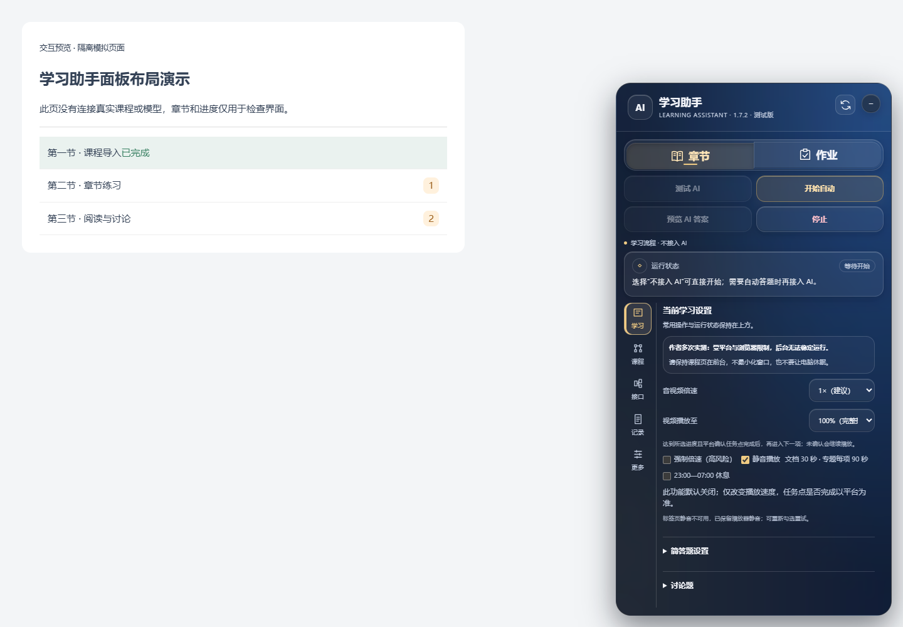
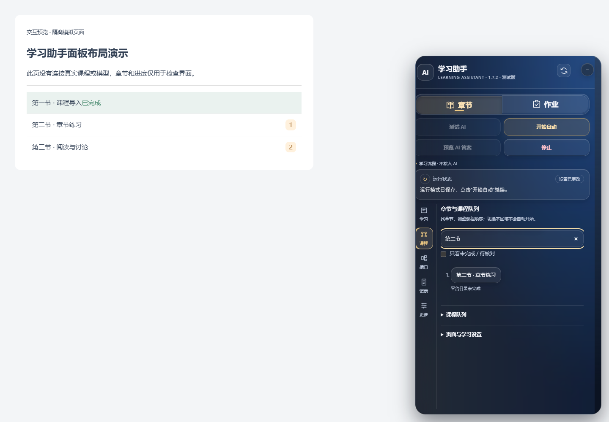
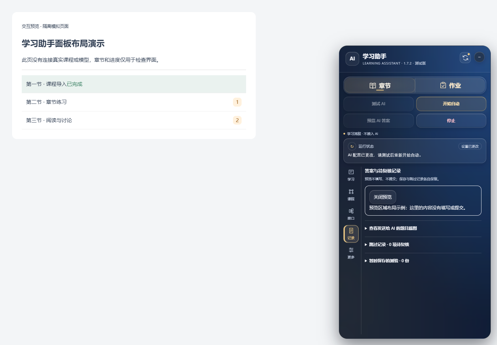
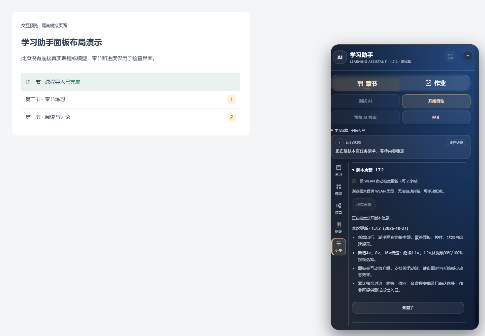
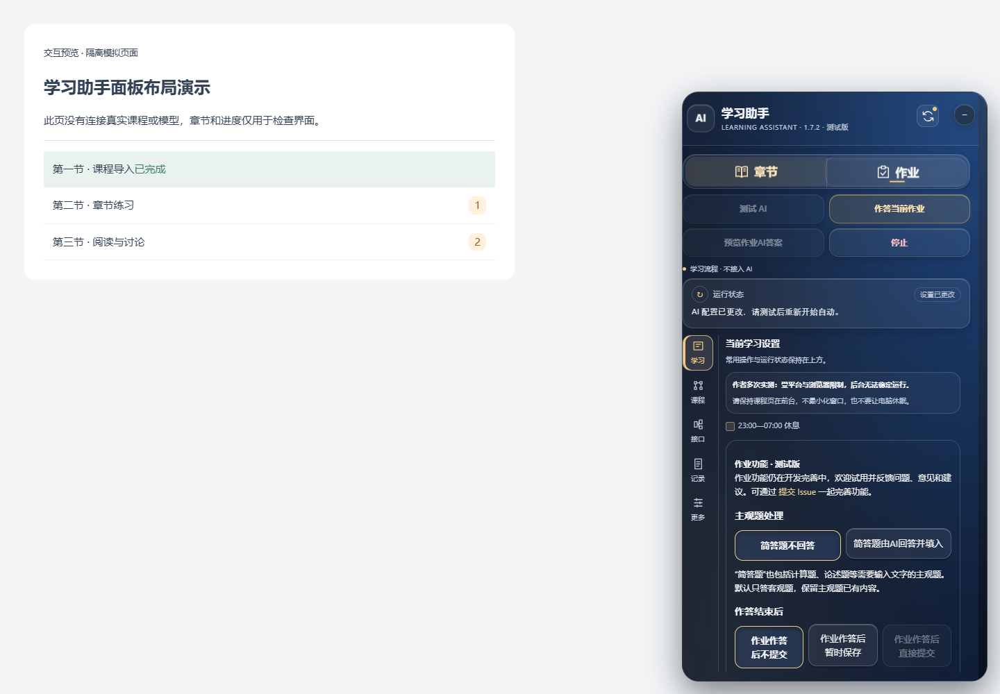
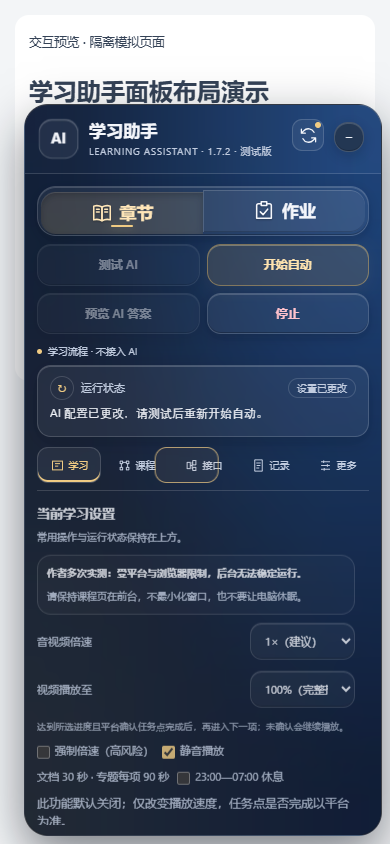
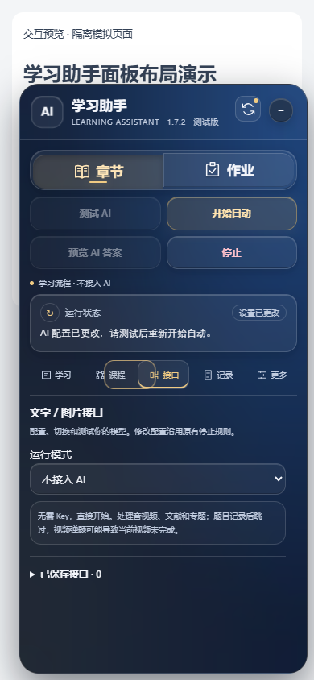

# 面板分区：1.7.4

面板上方保留章节/作业两个学习板块、开始/停止、AI测试/答案预览和运行状态。已移除考试占位入口及更新计划提示。右上角的小图标可直接检查脚本更新，操作期间不需要退出当前学习任务。

## 五个工作区

| 入口 | 放了什么 |
| --- | --- |
| 学习 | 媒体倍速、静音、夜间设置、简答题/讨论策略；作业模式下显示相应作业选项；最下方是“页面与学习设置” |
| 课程 | 章节搜索、待处理筛选、原生入口定位、课程队列 |
| 接口 | 运行模式、文字/图片接口、已保存配置和用途选择 |
| 记录 | AI答案预览、跳过记录、集中补做、暂存测验返回与诊断导出 |
| 更多 | 外观主题、版本检查/更新说明及反馈入口 |

切换工作区仅改变显示，不会开始学习、测试接口或提交。各区分别保留滚动位置。答案预览出现时会切到记录区；手动切走后再返回仍可查看。用方向键、Home/End可切换侧栏按钮；窄屏改成横排入口。

窄版目前随页面宽度自动切换，没有手动宽／窄按钮。把浏览器窗口缩窄，页面可视宽度不超过600 CSS像素时会自动采用横向标签。主题预览页里的“桌面／390窄屏”只切换示例截图，不会更改已安装脚本。

AI背景从模式栏开始覆盖操作和状态区域，模式栏与下方控件统一半透明玻璃材质；装饰独立定位，不占内容流、不增加顶部空白。所有主题的模式栏、操作按钮、状态、工作区侧栏和内容起点按同一布局对齐；不会为了装饰图把按钮或设置往下推。顶部小人物仍独立定位。

## 实际脚本的隔离预览

下图运行真实候选脚本，课程内容、题目和更新返回由本地夹具模拟。未安装到用户真实课程，不证明平台任务点、真实提交或得分。

| 课程定位 | 文字与图片接口 |
| --- | --- |
|  |  |

| 答案与复核记录 | 右上角检查更新后显示处理中 |
| --- | --- |
|  |  |

窄屏使用横向分区入口，开始、停止和状态依旧保留在上方：

 

## 布局改动对照

| Before | After | Why |
| --- | --- | --- |
| 为人物增加最多160像素占位，侧栏和内容被推下 | 删除占位，只移动绝对定位的背景画布 | 装饰不改变按钮对齐与可用内容高度 |
| 接口、任务、外观与日志放在一条长滚动区 | 五个独立工作区，各自滚动 | 找某项功能时直接定位入口 |
| 向下翻设置后看不到停止 | 主操作与状态留在固定区域 | 配置和查记录时仍可立即停止 |
| 更新按钮在下方折叠区 | 右上角小图标直接发起已有公开版本检查 | 显示检查中、失败或可用更新，结果可见；不自动安装 |
| 预览答案插在状态下面，可能挤压所有区域 | 完整预览放入记录区并自动定位 | 长答案不占用所有工作区的空间 |
| 桌面侧栏在手机宽度下占据太多空间 | 窄屏使用横排按钮 | 给表单和长文本保留宽度 |

保留原来的主题、控件实例和操作语义。实际适配/验证范围以发布验收范围为准，不把界面截图或模拟成功当成真实成绩。

