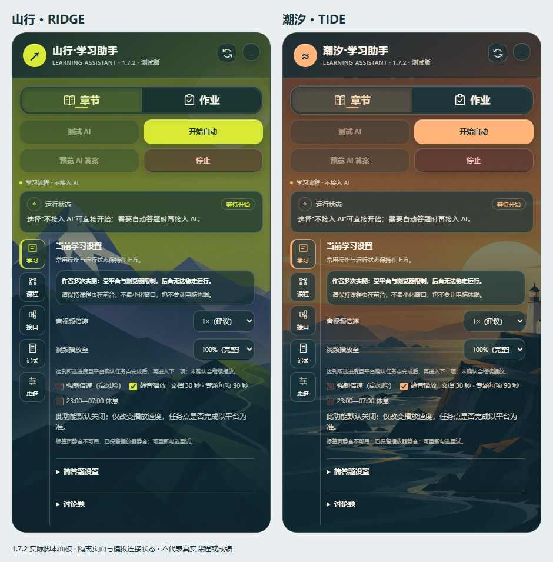
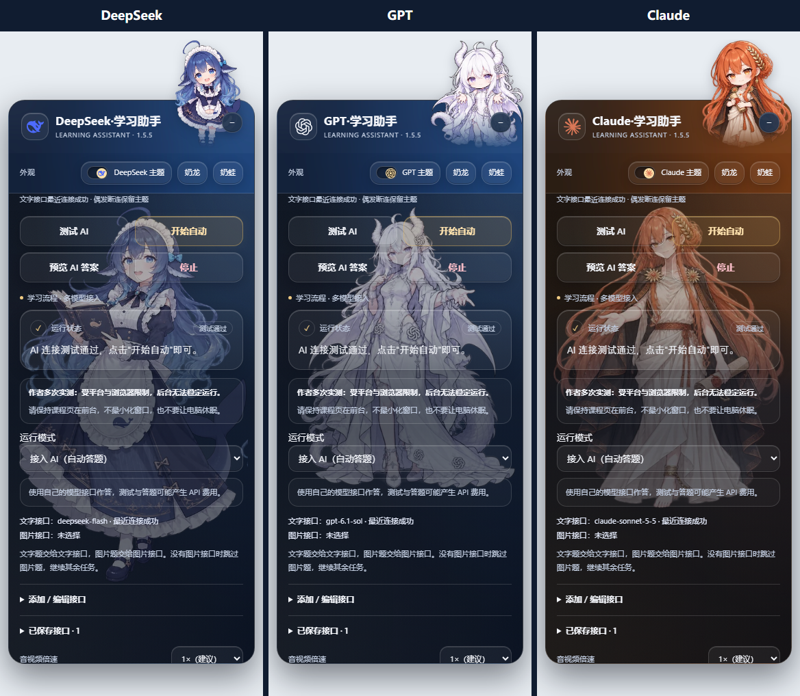
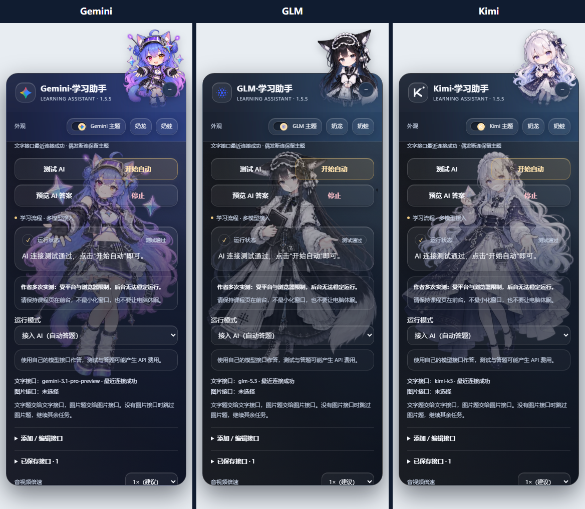
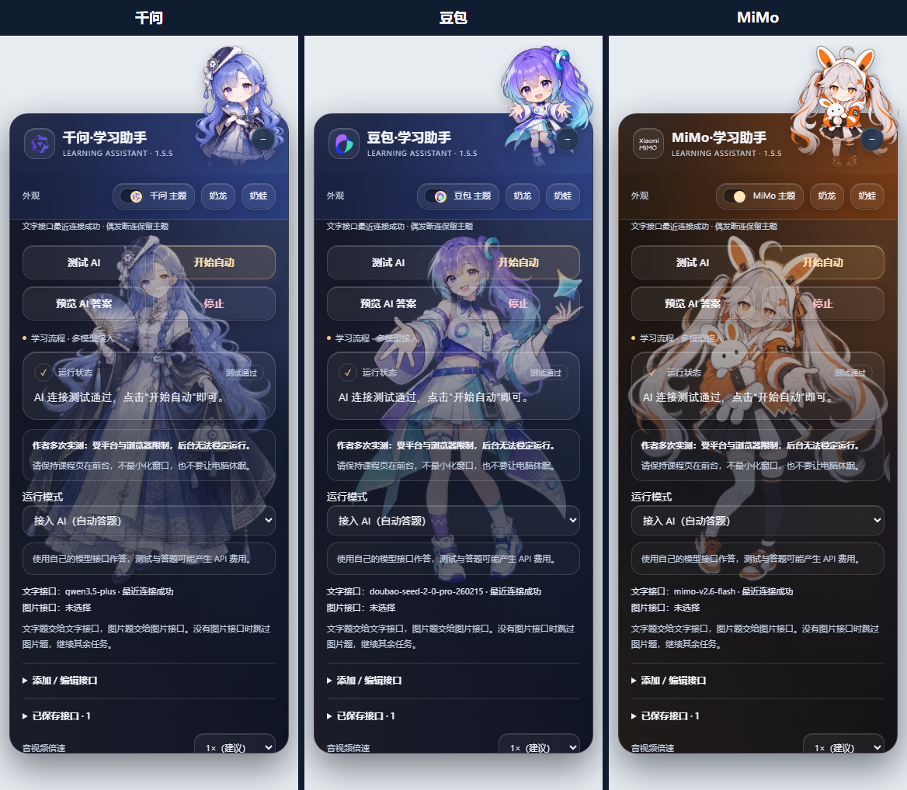

# 1.7.2 山行 / 潮汐

“山行”是荧光黄绿与深蓝山峦；“潮汐”是暖橙与深海灯塔。两套为独立默认主题，在“更多 → 外观”选择，不需要模型接口。原创插画由内置imagegen生成，参考图仅用于风格；名称、按钮和正文均由代码绘制，图片不承载交互。配色覆盖面板、导航、状态、输入和倍速提示。

本轮14款主题均由同一1.7.2脚本重新渲染。点击名称查看桌面原图；这些页面使用模拟连接状态，没有真实模型调用。

| 独立默认主题 | AI主题 |
| --- | --- |
| [山行](themes/v172/ridge-desktop.png) · [潮汐](themes/v172/tide-desktop.png) | [DeepSeek](themes/v172/deepseek-desktop.png) · [GPT](themes/v172/openai-desktop.png) · [Claude](themes/v172/claude-desktop.png) |
| [默认](themes/v172/default-desktop.png) · [奶龙](themes/v172/nailoong-desktop.png) · [奶蛙](themes/v172/naiwa-desktop.png) | [Gemini](themes/v172/gemini-desktop.png) · [GLM](themes/v172/zhipu-desktop.png) · [Kimi](themes/v172/kimi-desktop.png) |
| [山行窄屏](themes/v172/ridge-mobile.png) · [潮汐窄屏](themes/v172/tide-mobile.png) | [千问](themes/v172/qwen-desktop.png) · [豆包](themes/v172/doubao-desktop.png) · [MiMo](themes/v172/xiaomi-desktop.png) |

下方旧角色图保留来源与历史版本说明；并非本轮新版布局截图。

# AI 主题界面图鉴

文字接口测试通过后自动切换到对应 AI 主题（本地 Codex 对应 GPT），即使之前选择默认、奶龙、奶蛙、山行或潮汐，也无需再次手动开启。测试后仍可手动选择外观，直到下次文字测试通过再自动匹配。测试失败不会强制开启主题；下方展示九种主题的实际脚本面板。所有截图使用相同面板宽度和画布尺寸，按钮紧凑排列，背景透过玻璃控件显示。默认 / AI 开关可切回普通界面；奶龙、奶蛙可单独切换。切回默认时，标题恢复“学习助手”，左上角恢复“AI”。

原角色设计作者：B 站 UP 主 **[ZipZipPipe](https://space.bilibili.com/4168597)**（[B 站个人空间](https://space.bilibili.com/4168597)）。本项目依据其角色形象生成适合界面的背景、Q 版和测试动效素材，不代表服务商官方角色或合作关系。

以下展示图由 **1.5.5** 脚本实际渲染，使用模拟接口展示主题；不是模型能力实测。点击任一小图可放大查看。

[DeepSeek 大图](themes/deepseek.png) · [GPT 大图](themes/openai.png) · [Claude 大图](themes/claude.png)

[Gemini 大图](themes/gemini.png) · [GLM 大图](themes/zhipu.png) · [Kimi 大图](themes/kimi.png)

[千问大图](themes/qwen.png) · [豆包大图](themes/doubao.png) · [MiMo 大图](themes/xiaomi.png)

## 测试反馈与连接状态

测试结果以无边框角色动画居中出现，人物下方显示通过、失败及原因；支持关闭和系统“减少动态效果”。未知模型没有参考角色时保持默认。

主题以文字接口为准，图片接口不会改变主主题。偶发断连不会马上切回；连续失败并经过观察后退回默认。更换模型或密钥需要重新测试，成功状态最长保留 24 小时。主题只是最近连接状态的提示，不保证持续可用、余额充足或答案正确。

素材内置在脚本，不向角色图床发送模型、密钥或题目。模型图标取自 MIT 的 LobeHub/lobe-icons，固定版本、来源与校验值见[图标清单](../assets/model-icons/manifest.json)，完整许可见同目录 LICENSE.txt。
