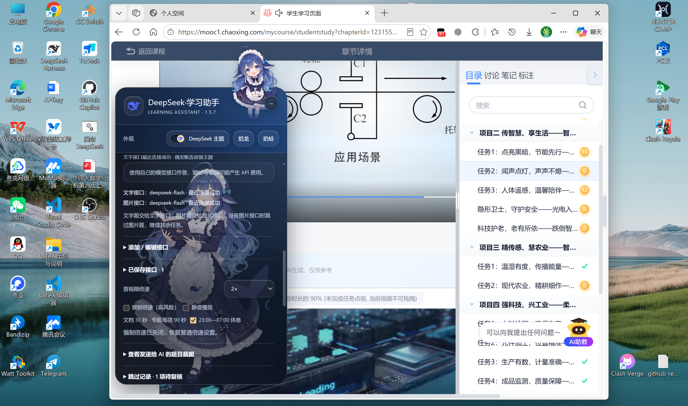
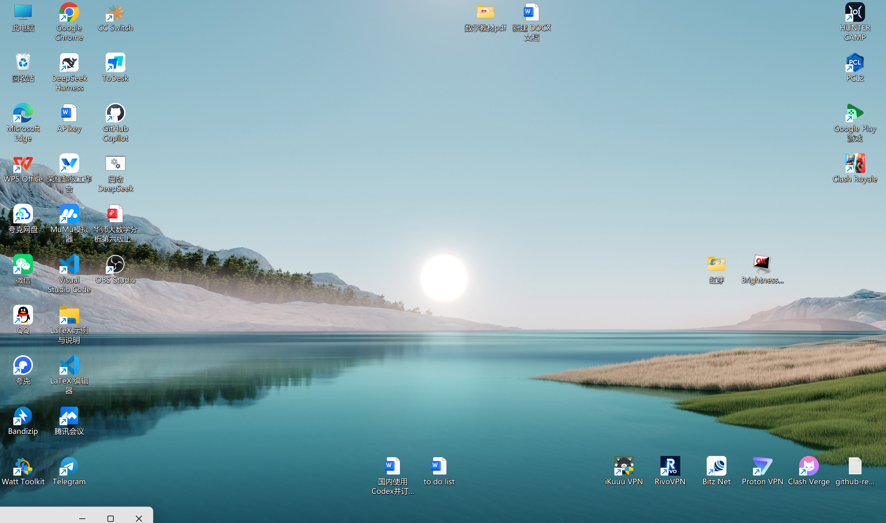
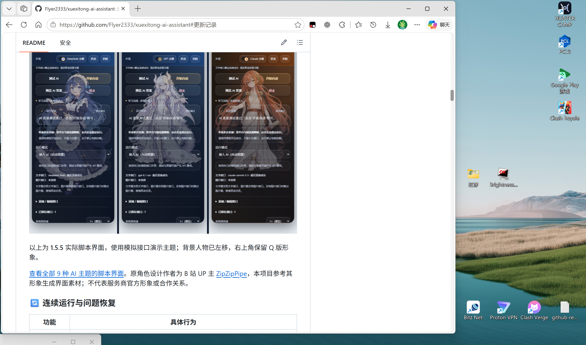
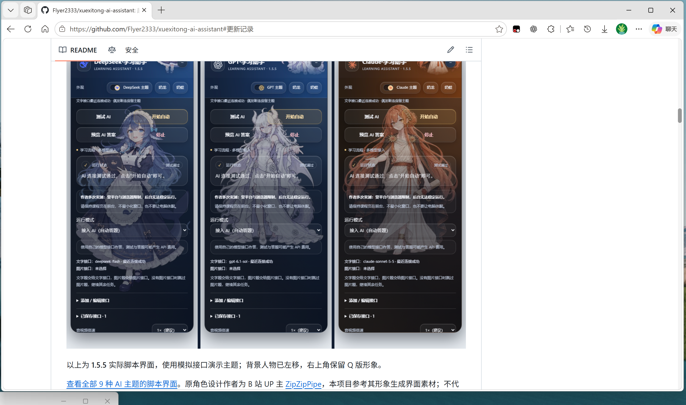

# 独立窗口保留可见角落

[返回 README](../README.md#开始前记住这几件事)

这是作者推荐的一种“类后台”摆放方式：让课程在独立浏览器窗口中运行，保留左下角一小块可见区域，同时使用另一个窗口做其他工作。它依靠真实窗口摆放，不改写页面可见性。

下面四张截图由作者提供，按同一次操作顺序展示。窗口位置是示例，可以按屏幕大小调整。

## 1. 把课程放在独立窗口，取消最大化

打开课程并确认脚本正在运行。如果课程和工作页在同一窗口的不同标签中，先把课程标签拖出来，成为单独窗口。点击右上角“还原”按钮，让窗口可以自由拖动；若正在 F11 全屏，先按 F11 退出全屏。

**图 1：运行脚本的课程页面，已经是可拖动的普通窗口。**

## 2. 把课程窗口移到桌面左下角

拖住课程窗口顶部的标题栏向左下方移动，让它大部分处于屏幕外，**保留一小块在屏幕内**。不要点最小化，不要切换这个窗口里的课程标签，也不要关闭窗口。

**图 2：课程窗口移到左下角，底部左侧还露出一条窗口边缘。** 这张图主要展示摆放位置。实际使用时建议比图中多露出一些课程内容，便于观察播放和脚本状态；没有通用的“露出几个像素就一定有效”的尺寸。

## 3. 打开工作窗口，同样取消最大化

打开自己要看的网页、文档或其他软件窗口。也将它还原为普通窗口，放在屏幕上方。截图用 GitHub 页面作为工作窗口示例。

**图 3：工作窗口处于非最大化状态，左下角课程窗口露出的部分仍未被遮住。**

## 4. 手动拉大工作窗口，留下左下角

拖动工作窗口的右边框、下边框或右下角，把它拉到接近整个屏幕大小。**用拖边框的方式拉大，不要点最大化或进入全屏**，以免盖住左下角留下的课程窗口。

图 3 到图 4 展示的就是这一步：工作页面变宽、接近全屏，左下角仍留出课程窗口的可见角落。后续可以在这个工作窗口中操作，偶尔回课程窗口检查是否继续播放、是否出现人工验证或待复核提示。

## 使用时留意

- 电脑保持唤醒；课程窗口不最小化，露出的部分不被其他窗口完全盖住。误点最大化后，重新还原并调整即可。
- 先用自己当前课程短时间观察，再决定露出范围；遇到停播或卡住，回到课程页查看提示。不要把脚本计时结束当作平台任务点已完成。
- 这是一种窗口摆放建议，效果受浏览器、系统和课程规则影响，不能保证持续运行。专题阅读仍要求前台且有焦点计时，在其他窗口工作时可能暂停，不适用“留一点角落就继续累计”的推断。
- 静音可使用脚本里的“静音播放”，具体行为见 [标签页静音说明](TAB_MUTE.md)。

